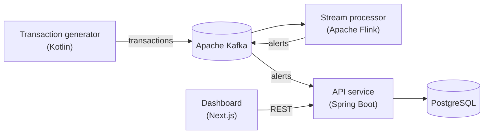

# Real Time Fraud Detection Pipeline

[](https://github.com/AvikSh14/fraud-detection-pipeline/actions/workflows/ci.yml)

A streaming data platform that models how payment companies catch fraudulent
transactions the moment they occur. A Kotlin service generates a realistic stream
of card transactions into Apache Kafka. An Apache Flink job reads that stream and
applies time based aggregations and anomaly rules to flag suspicious activity. A
Spring Boot service stores the resulting alerts in PostgreSQL and serves them over
a REST API to a Next.js dashboard, which shows the live stream, the alerts, and how
detection accuracy shifts as different attack patterns are launched.

I am building this as a learning project and holding it to production standards
as it grows: typed and validated configuration, explicit delivery guarantees,
tests, versioned database migrations, protected branches, and a proper review
workflow.

> Status: active development. The local Kafka and PostgreSQL setup, the transaction
> generator's building blocks, and the API service's alert storage, review workflow,
> and read endpoints work today. The status change endpoint and observability are in
> progress. The Flink processor and the dashboard come later.

## Architecture



## How it works

This section describes the target design. See [Status](#status) for what is built
today.

1. **Transaction generator (Kotlin).** A long running service that emits a steady,
   configurable stream of realistic card transactions into Kafka. Transactions are
   keyed by card ID so each card's history stays in order on one partition. The
   producer is idempotent and waits for acknowledgement from all in-sync replicas,
   so a transaction is never silently dropped or duplicated. Deliberate fraud
   scenarios such as card testing and account takeover will be published with a
   ground truth label on a separate topic, so detection accuracy can be measured
   honestly.
2. **Stream processor (Apache Flink).** Reads the transaction stream and applies
   windowed aggregations, event time watermarks for late or out of order data, and
   anomaly rules to decide which transactions look fraudulent. Flagged transactions
   are published as alerts to their own Kafka topic.
3. **API service (Spring Boot).** The system of record for alerts. It consumes the
   alert topic and persists each alert to PostgreSQL, with writes that are safe to
   repeat when Kafka redelivers a message. It exposes a REST API for listing alerts,
   viewing details, and moving an alert through its review workflow, with every
   status change kept in an audit trail. The schema is managed with Flyway
   migrations.
4. **Dashboard (Next.js).** A live view of the transaction stream, real time fraud
   alerts, controls to launch attack simulations on demand, accuracy metrics that
   compare what was detected against what was actually fraud, and short
   explanations of how the detection logic works.

## Status

### Done

* Single node Apache Kafka cluster running in KRaft mode, so no ZooKeeper, set up
  with Docker Compose. Internal, external, and controller traffic are configured on
  separate listeners, and data survives restarts.
* A transaction data model and a generator that produces randomized sample
  transactions, keyed by card ID so related transactions land on the same
  partition. The generator currently publishes a small batch of them to Kafka.
* Verified the full path from producer to broker to consumer, including how Kafka
  routes messages to partitions by key.
* Building blocks for the streaming generator, each unit tested and ready to be
  wired into the running service:
  * Configuration loaded with Hoplite from a config file, with environment
    variable overrides for every setting, and validation that reports every
    invalid field in one pass.
  * Kafka producer settings built by a pure function, with idempotence and full
    acknowledgement enabled, and a unique client ID per running instance so
    multiple instances can be told apart in broker logs and metrics.
  * An asynchronous Kafka producer with delivery callbacks that count successful
    and failed sends in thread safe counters.
  * Unit tests using Kafka's `MockProducer`, so they run without a broker.
* PostgreSQL 16 in Docker Compose next to Kafka, with its data in a named volume.
* Alert storage in the API service (Spring Boot 4, Kotlin, Hibernate 7):
  * Schema managed by four Flyway migrations: the `alerts` table, an append only
    `alert_status_history` audit table, a version column for optimistic locking,
    and a database trigger that rejects any update to history rows, so the audit
    trail cannot be changed by any client.
  * JPA entities and Spring Data repositories. Optimistic locking with `@Version`
    rejects stale writes instead of silently overwriting them.
* Alert review workflow: an explicit state machine (`NEW` to `IN_REVIEW` to
  `CONFIRMED_FRAUD` or `FALSE_POSITIVE`). A status change checks the allowed
  transition and the expected version, and writes the audit row in the same
  database transaction.
* REST read API:
  * `GET /alerts`: paged list, newest first, with an optional status filter.
  * `GET /alerts/{id}`: one alert with an `ETag` header, answering
    `304 Not Modified` when the client's copy is current.
  * `GET /alerts/{id}/history`: the alert's status changes in order.
  * Errors returned as RFC 9457 Problem Details (`application/problem+json`).
* `PATCH /alerts/{id}/status`: moves an alert through the review workflow. The
  client must send the `ETag` it received in an `If-Match` header, so two analysts
  editing the same alert cannot overwrite each other's change (`412` for a stale
  version, `428` when the header is missing, `409` for a forbidden transition).
  An integration test against a real PostgreSQL proves a lost update is refused.
* 38 automated tests in the API service: repository tests against a real
  PostgreSQL through Testcontainers, controller tests with `@WebMvcTest`, service
  tests, and a test that keeps the Kotlin status enum and the database constraints
  in sync.
* Continuous integration with GitHub Actions: each pull request builds and tests
  only the Gradle modules it changed, lints and builds the dashboard, and reports
  one aggregate check that branch protection requires.
* Repository hardening: branch rulesets, CodeQL code scanning, grouped automated
  dependency updates, secret scanning that blocks leaked credentials before they
  are pushed, and a security disclosure policy.

### In progress

* Observability for the API service: liveness and readiness probes, Prometheus
  metrics including a business metric for status changes, request IDs in every
  log line, and structured JSON logs.
* Turning the generator into a real streaming service: wiring in the
  configuration and asynchronous producer above, a configurable send rate driven
  by coroutines, clean shutdown, and periodic throughput logging built on the
  delivery counters.

### Next

* Prometheus and Grafana dashboards, an alert rule, and a runbook.
* A Docker image for the API service, run in Docker Compose and built in CI.
* Alert ingestion in the API service: a Kafka consumer that writes alerts to
  PostgreSQL without duplicates, retries transient failures, and sends
  unprocessable messages to a dead-letter topic.
* A transactional outbox, so confirmed fraud events are published reliably after
  the database commit.
* Idempotency keys for endpoints that create data, so a retried request never
  creates a duplicate.
* JWT authentication and role based access with Spring Security.
* AWS infrastructure with Terraform, developed against a local AWS emulator.
* Publishing ground truth fraud labels on a dedicated Kafka topic so accuracy can
  be evaluated later.
* Realistic per card spending behaviour and injected fraud attack patterns such as
  card testing, account takeover, and impossible travel between locations.
* The Apache Flink detection job, publishing alerts to Kafka.
* The Next.js dashboard, with controls to launch attack simulations.

## Tech stack

| Area | Tools |
| --- | --- |
| Languages and runtime | Kotlin, Kotlin Coroutines (in progress), JVM 21 |
| Streaming and messaging | Apache Kafka in KRaft mode, Apache Flink (planned) |
| Backend services | Spring Boot 4, Spring Web MVC, Spring Data JPA, Hibernate 7, Spring Boot Actuator |
| Storage | PostgreSQL 16, Flyway |
| Frontend | Next.js, TypeScript, React, Tailwind CSS |
| Build and tooling | Gradle with the Kotlin DSL and version catalogs, Hoplite, kotlinx.serialization, kotlin-logging |
| Infrastructure | Docker, Docker Compose |
| Testing | JUnit 5, kotlin-test, Mockito, MockMvc, Testcontainers, Kafka MockProducer |
| CI and repository | GitHub Actions, CodeQL, Dependabot, secret scanning with push protection |
| Practices | Pull request workflow with protected branches, optimistic locking, versioned migrations, RFC 9457 error responses |

## Repository layout

```
backend/event_generator     Kotlin transaction generator (Gradle, JDK 21)
backend/flink_processor     Apache Flink stream processor (Gradle, JDK 21, scaffold)
backend/api_service         Spring Boot alert service and REST API (Gradle, JDK 21)
dashboard                   Next.js dashboard (scaffold)
infrastructure              Docker Compose for Kafka and supporting services
```

## Running locally

Requires Docker and JDK 21.

Start the local infrastructure:

```bash
cd infrastructure
docker compose up -d
```

Create the transactions topic:

```bash
docker compose exec kafka kafka-topics \
  --bootstrap-server localhost:9092 \
  --create --topic transactions --partitions 3 --replication-factor 1
```

Run the generator and its tests. For now it publishes a small batch of sample
transactions and exits. The continuous stream is in progress.

```bash
cd backend/event_generator
./gradlew run
./gradlew test
```

Watch the transactions arrive:

```bash
cd infrastructure
docker compose exec kafka kafka-console-consumer \
  --bootstrap-server localhost:9092 --topic transactions --from-beginning
```

Run the API service. It needs the PostgreSQL container from the infrastructure
step, and Flyway applies the migrations on startup.

```bash
cd backend/api_service
./gradlew bootRun
curl http://localhost:8080/actuator/health
curl "http://localhost:8080/alerts?status=NEW&page=0&size=20"
```

Run the API service's tests. Docker must be running, because Testcontainers
starts a throwaway PostgreSQL for them.

```bash
cd backend/api_service
./gradlew test
```

Stop the infrastructure when you are done:

```bash
cd infrastructure
docker compose down
```

## Security

See [SECURITY.md](SECURITY.md) for how to report a vulnerability.
